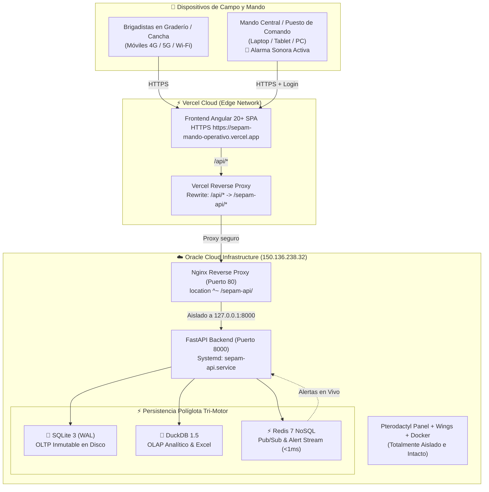

# 🚑 SEPAM - Sistema de Mando Operativo y Triaje Prehospitalario

Sistema integral de gestión de emergencias médicas, triaje táctico y mando operativo en tiempo real para eventos de concentración masiva (estadios, conciertos, ferias y recintos cerrados/abiertos).

Diseñado con arquitectura **100% Cloud Server-Side**, alta disponibilidad con **HTTPS constante**, motor analítico de alto rendimiento y acceso instantáneo para brigadistas móviles sin instalación previa.

---

## 🌟 Características Principales

- **Triaje Táctico Rápido (Método START):** Registro ágil de pacientes en menos de 15 segundos con clasificación por código de colores (Rojo: Crítico, Amarillo: Urgente, Verde: Leve, Negro: Fallecido).
- **Tablero de Control de Mando Operativo:** Monitoreo en vivo de pacientes atendidos, altas en puesto médico de avanzada (PMA), derivaciones a carpas y traslados en ambulancia a hospitales de la red pública.
- **Acceso Móvil Plug & Play vía Código QR:** Los brigadistas en cancha o graderíos escanean el código QR oficial desde su navegador móvil (Chrome, Safari) usando su plan de datos 4G/5G o el Wi-Fi del evento.
- **Persistencia Políglota Tri-Motor (Gold Standard en Emergencias):**
  - **SQLite 3 en modo WAL (Write-Ahead Logging):** Motor transaccional (OLTP) de alta concurrencia que registra atenciones en microsegundos sin bloqueos.
  - **DuckDB 1.5 OLAP Engine:** Motor columnar en memoria para analítica vectorizada instantánea y generación al vuelo de reportes ejecutivos en formato **Excel (`.xlsx`)** y **CSV**.
  - **Redis 7 NoSQL In-Memory & Pub/Sub:** Sistema de mensajería ultrarrápido (<1ms) para alertas críticas instantáneas (Triage Rojo/Amarillo), alarma acústica y caché de métricas en memoria.
- **Blindaje y Convivencia en la Nube:** Coexistencia armónica con servidores de juego (Pterodactyl, Wings Daemon y Docker) en la misma instancia de Oracle Cloud sin conflictos de puertos ni colisiones de API.

---

## 🏗️ Arquitectura del Sistema



---

## 🔐 Credenciales de Acceso

El sistema cuenta con control de acceso basado en roles (RBAC):

| Rol | Usuario | Contraseña | Permisos |
| :--- | :--- | :--- | :--- |
| **Super Usuario (Mando Central)** | `pedro.zavala` | `admin1` | Acceso completo: Tablero táctico, métricas en vivo, descarga de reportes Excel, configuración del evento y generación de Códigos QR para el personal. |
| **Brigadista de Campo** | *(Sin login requerido)* | *(Acceso QR directo)* | Formulario simplificado de ingreso rápido de atenciones y triaje. |

---

## 📂 Estructura del Repositorio

```text
sepam-mando-operativo/
├── src/                               # Frontend Angular 20+
│   ├── app/
│   │   ├── components/
│   │   │   ├── admin-panel/           # Panel táctico y auditoría
│   │   │   ├── triage-form/           # Formulario rápido de triaje
│   │   │   ├── header/                # Barra superior con botón QR y estado
│   │   │   ├── network-modal/         # Modal de código QR oficial y enlace móvil
│   │   │   └── statistics/            # Gráficos y distribución de atenciones
│   │   ├── services/
│   │   │   ├── database.service.ts    # Comunicación HTTP dinámica (/api)
│   │   │   ├── network.service.ts     # Generación de URLs y QR de producción
│   │   │   └── auth.service.ts       # Sesión y roles de usuarios
│   │   └── app.component.ts           # Componente raíz
│   └── styles.css                     # Estilos tácticos médicos de alta visibilidad
├── backend/                           # Backend Python FastAPI
│   ├── main.py                        # Endpoints REST (/api/atenciones, /api/analitica/...)
│   ├── database.py                    # Capa DuckDB 1.5 + SQLite WAL
│   └── requirements.txt               # fastapi, uvicorn, duckdb, pandas, openpyxl
├── vercel.json                        # Configuración de despliegue y proxy en Vercel
├── pterodactyl_with_sepam.conf        # Configuración de Nginx blindada para Oracle Cloud
├── sepam-api.service                  # Definición de servicio Systemd para el backend
└── README.md                          # Documentación completa del proyecto
```

---

## 🚀 Despliegue en Producción

### 1. Frontend en Vercel
1. Ingresa a tu panel en [Vercel](https://vercel.com/new).
2. Importa el repositorio **`PeterPandaDeveloper/sepam-mando-operativo`**.
3. Vercel detectará el framework **Angular** y el archivo `vercel.json` automáticamente.
4. Presiona **Deploy**. Tendrás disponible tu URL oficial con HTTPS activado (ej. `https://sepam-mando-operativo.vercel.app`).

### 2. Backend en Oracle Cloud (`150.136.238.32`)
El backend corre como un servicio persistente gestionado por Systemd:

```bash
# Ver estado del servicio
sudo systemctl status sepam-api

# Reiniciar servicio (si se aplican cambios al backend)
sudo systemctl restart sepam-api

# Ver logs en tiempo real
sudo journalctl -u sepam-api -f
```

### 3. Configuración de Nginx Blindada (Convivencia con Pterodactyl)
Para evitar cualquier colisión con el panel de juegos o el demonio Wings, Nginx redirige el tráfico de SEPAM mediante un prefijo exclusivo `/sepam-api/`:

```nginx
# En /etc/nginx/sites-available/pterodactyl.conf
server {
    listen 80;
    server_name 150.136.238.32;

    # SEPAM Backend Proxy Aislado
    location ^~ /sepam-api/ {
        proxy_pass http://127.0.0.1:8000/api/;
        proxy_set_header Host $host;
        proxy_set_header X-Real-IP $remote_addr;
        proxy_set_header X-Forwarded-For $proxy_add_x_forwarded_for;
        proxy_set_header X-Forwarded-Proto $scheme;
    }

    # Pterodactyl y Wings (Intactos)
    location / {
        try_files $uri $uri/ /index.php?$query_string;
    }
    ...
}
```

---

## 🛠️ Desarrollo Local

### Prerrequisitos
- Node.js 20+ y npm
- Python 3.12+

### Iniciar Frontend
```bash
npm install
npm run start
# Abre http://localhost:4200
```

### Iniciar Backend
```bash
cd backend
python -m venv venv
# En Windows:
.\venv\Scripts\activate
# En Linux/macOS:
source venv/bin/activate

pip install -r requirements.txt
python main.py
# API disponible en http://localhost:8000/docs
```

---

## 📊 Endpoints Clave del Backend

- `GET /api/estado`: Comprueba el estado del sistema, evento activo y totales.
- `GET /api/atenciones`: Listado de pacientes registrados en tiempo real.
- `POST /api/atenciones`: Registro de nueva atención de triaje.
- `GET /api/analitica/resumen`: Estadísticas procesadas con DuckDB (por sector, prioridad, tipo).
- `GET /api/analitica/exportar-excel`: Genera y descarga el informe oficial en `.xlsx`.

---

## 📄 Licencia y Créditos
Desarrollado para el equipo de Mando Operativo de Emergencias Prehospitalarias y Cobertura de Eventos Masivos.  
Autor: **Pedro Zavala M. (PeterPandaDeveloper)**
